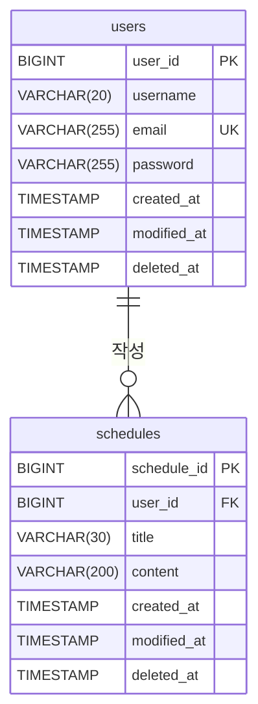

## API 명세서

### 인증 방식

Cookie/Session 방식으로 인증합니다.

- 로그인에 성공하면 서버가 `Set-Cookie` 헤더로 세션 ID(`JSESSIONID`)를 발급합니다.
- 🔒 표시된 API는 `Cookie` 헤더에 세션 ID를 담아 요청해야 합니다. (브라우저·Postman은 자동으로 보냅니다)
- 세션은 마지막 요청 후 30분이 지나거나 로그아웃하면 만료됩니다.
- 세션이 없거나 만료된 상태로 🔒 API를 호출하면 `401 Unauthorized`를 반환합니다.

### 공통 에러 응답

모든 에러는 아래 형식으로 응답합니다.

|필드|타입|설명|
|--|--|--|
|`status`|Integer|HTTP 상태 코드|
|`message`|String|에러 메시지|
|`errors`|Object|필드별 검증 실패 사유 (입력값 검증 실패 시에만 포함)|

```json
{
    "status": 404,
    "message": "존재하지 않는 일정입니다."
}
```

입력값 검증에 실패하면 `errors`에 필드별 사유가 함께 담깁니다.

```json
{
    "status": 400,
    "message": "입력값이 올바르지 않습니다.",
    "errors": {
        "title": "30자 이내로 작성해주세요.",
        "content": "내용을 입력해주세요."
    }
}
```

### 인증(auth)

|Method|URI|기능|로그인|
|--|--|--|--|
|POST|`/api/v1/auth/login`|로그인|-|
|POST|`/api/v1/auth/logout`|로그아웃|🔒|

<details>
<summary><h3>로그인</h3></summary>

이메일과 비밀번호로 로그인합니다.<br>
로그인에 성공하면 서버에 세션이 생성되고, 세션 ID가 쿠키(`JSESSIONID`)로 발급됩니다. <br>
탈퇴한 유저는 로그인할 수 없습니다.

|메서드|요청 URL|
|--|--|
|POST|`/api/v1/auth/login`

**Request Headers**

|Key|Value|필수|설명|
|--|--|--|--|
|`Content-Type`|`application/json`|✅|요청 본문 형식|

**Request Body**

|필드|타입|필수|설명|
|--|--|--|--|
|`email`|String|✅|이메일 (이메일 형식)|
|`password`|String|✅|비밀번호|

```json
{
    "email": "gildong@example.com",
    "password": "password1234"
}
```

**Response** `200 OK` (응답 바디 없음)

**Response Headers**

|Key|Value|설명|
|--|--|--|
|`Set-Cookie`|`JSESSIONID={세션 ID}; Path=/; HttpOnly`|로그인 세션 ID|

**Error Response**

|상태 코드|상황|
|--|--|
|`400 Bad Request`|입력값 검증 실패 (필수값 누락, 이메일 형식 오류)|
|`401 Unauthorized`|이메일 또는 비밀번호 불일치 (탈퇴한 유저 포함)|

</details>

<details>
<summary><h3>로그아웃</h3></summary>

현재 로그인 세션을 서버에서 무효화합니다.<br>
로그아웃 후에는 이전 세션 ID로 요청해도 로그인 상태로 처리되지 않습니다.

|메서드|요청 URL|
|--|--|
|POST|`/api/v1/auth/logout`

**Request Headers**

|Key|Value|필수|설명|
|--|--|--|--|
|`Cookie`|`JSESSIONID={세션 ID}`|✅|로그인 세션 ID|

**Response** `204 No Content`

**Error Response**

|상태 코드|상황|
|--|--|
|`401 Unauthorized`|로그인하지 않았거나 이미 만료된 세션|

</details>

### 일정(schedule)

|Method|URI|기능|로그인|
|--|--|--|--|
|POST|`/api/v1/schedules`|일정 생성|🔒|
|GET|`/api/v1/schedules`|일정 전체 조회|🔒|
|GET|`/api/v1/schedules/{scheduleId}`|일정 단건 조회|🔒|
|PATCH|`/api/v1/schedules/{scheduleId}`|일정 수정|🔒|
|DELETE|`/api/v1/schedules/{scheduleId}`|일정 삭제|🔒|

<details>
<summary><h3>일정 생성</h3></summary>

할일 제목, 할일 내용을 입력받아 일정을 생성합니다. 작성자는 로그인한 유저로 자동 지정됩니다.<br>
작성일과 수정일은 서버에서 자동으로 저장됩니다.

|메서드|요청 URL|
|--|--|
|POST|`/api/v1/schedules`

**Request Headers**

|Key|Value|필수|설명|
|--|--|--|--|
|`Content-Type`|`application/json`|✅|요청 본문 형식|
|`Cookie`|`JSESSIONID={세션 ID}`|✅|로그인 세션 ID|

**Request Body**

|필드|타입|필수|설명|
|--|--|--|--|
|`title`|String|✅| 할일 제목 (공백 불가, 최대 30자)|
|`content`|String|✅| 할일 내용 (공백 불가, 최대 200자)|

```json
{
    "title": "할일 제목",
    "content": "할일 내용",
}
```
**Response Body** `201 Created`

|필드|타입|설명|
|--|--|--|
|`scheduleId`|Long|일정 ID|
|`title`|String|할일 제목|
|`content`|String|할일 내용|
|`userId`|Long|작성자 ID|
|`createdAt`|LocalDateTime|작성일
|`modifiedAt`|LocalDateTime|수정일

```json
{
    "scheduleId": 1,
    "title": "할일 제목",
    "content": "할일 내용",
    "userId": 1,
    "createdAt": "2026-10-16T14:30:00",
    "modifiedAt": "2026-10-16T14:30:00"
}
```

**Error Response**

|상태 코드|상황|
|--|--|
|`400 Bad Request`|입력값 검증 실패 (필수값 누락, 제목·내용 공백, 제목 30자 초과, 내용 200자 초과)|
|`401 Unauthorized`|로그인하지 않았거나 세션이 만료된 경우|

</details>

<details>
<summary><h3>일정 전체 조회</h3></summary>

전체 일정을 수정일 기준 내림차순으로 조회합니다.<br>
작성자 ID(`userId`)를 입력하면 해당 유저의 일정만 조회합니다.<br>
삭제된 일정은 조회되지 않습니다.

|메서드|요청 URL|
|--|--|
|GET|`/api/v1/schedules`

**Request Headers**

|Key|Value|필수|설명|
|--|--|--|--|
|`Cookie`|`JSESSIONID={세션 ID}`|✅|로그인 세션 ID|

**Query Parameter**

|필드|타입|필수|설명|
|--|--|--|--|
|`userId`|Long|❌| 작성자 ID

**Response Body** `200 OK`

> 수정일(`modifiedAt`) 기준 내림차순 정렬

|필드|타입|설명|
|--|--|--|
|`scheduleList`|List|일정 목록|
|`scheduleList[].scheduleId`|Long|일정 ID|
|`scheduleList[].title`|String|할일 제목|
|`scheduleList[].content`|String|할일 내용|
|`scheduleList[].userId`|Long|작성자 ID|
|`scheduleList[].createdAt`|LocalDateTime|작성일|
|`scheduleList[].modifiedAt`|LocalDateTime|수정일|

```json
{
    "scheduleList": [
        {
            "scheduleId": 1,
            "title": "제목",
            "content": "내용",
            "userId": 1,
            "createdAt": "2026-10-14T17:09:00",
            "modifiedAt": "2026-10-14T17:09:00"
        },
        {
            "scheduleId": 3,
            "title": "제목",
            "content": "내용",
            "userId": 2,
            "createdAt": "2026-10-08T17:09:00",
            "modifiedAt": "2026-10-08T17:09:00"
        },
        {
            "scheduleId": 4,
            "title": "제목",
            "content": "내용",
            "userId": 2,
            "createdAt": "2026-10-07T17:09:00",
            "modifiedAt": "2026-10-07T17:09:00"
        },
        {
            "scheduleId": 2,
            "title": "제목",
            "content": "내용",
            "userId": 1,
            "createdAt": "2026-09-14T17:09:00",
            "modifiedAt": "2026-09-14T17:09:00"
        }
    ]
}
```

**Error Response**

|상태 코드|상황|
|--|--|
|`401 Unauthorized`|로그인하지 않았거나 세션이 만료된 경우|

</details>

<details>
<summary><h3>일정 단건 조회</h3></summary>

일정 ID로 특정 일정 하나를 조회합니다.

|메서드|요청 URL|
|--|--|
|GET|`/api/v1/schedules/{scheduleId}`

**Request Headers**

|Key|Value|필수|설명|
|--|--|--|--|
|`Cookie`|`JSESSIONID={세션 ID}`|✅|로그인 세션 ID|

**Response Body** `200 OK`

|필드|타입|설명|
|--|--|--|
|`scheduleId`|Long|일정 ID|
|`title`|String|할일 제목|
|`content`|String|할일 내용|
|`userId`|Long|작성자 ID|
|`createdAt`|LocalDateTime|작성일
|`modifiedAt`|LocalDateTime|수정일

```json
{
    "scheduleId": 2,
    "title": "제목",
    "content": "내용",
    "userId": 1,
    "createdAt": "2026-09-14T17:09:00",
    "modifiedAt": "2026-09-14T17:09:00"
}
```

**Error Response**

|상태 코드|상황|
|--|--|
|`401 Unauthorized`|로그인하지 않았거나 세션이 만료된 경우|
|`404 Not Found`|존재하지 않거나 삭제된 일정 ID|

</details>

<details>
<summary><h3>일정 수정</h3></summary>

일정 ID로 특정 일정의 할일 제목이나 할일 내용을 수정합니다.<br>
수정할 필드만 보내면 되고, 최소 1개는 보내야 합니다. 수정일은 자동으로 갱신됩니다.<br>
본인이 작성한 일정만 수정할 수 있습니다.

|메서드|요청 URL|
|--|--|
|PATCH|`/api/v1/schedules/{scheduleId}`

**Request Headers**

|Key|Value|필수|설명|
|--|--|--|--|
|`Content-Type`|`application/json`|✅|요청 본문 형식|
|`Cookie`|`JSESSIONID={세션 ID}`|✅|로그인 세션 ID|

**Request Body**

|필드|타입|필수|설명|
|--|--|--|--|
|`title`|String|❌| 할일 제목 (공백 불가, 최대 30자)|
|`content`|String|❌| 할일 내용 (공백 불가, 최대 200자)|

```json
{
    "title": "할일 제목",
    "content": "할일 내용"
}
```
**Response Body** `200 OK`

|필드|타입|설명|
|--|--|--|
|`scheduleId`|Long|일정 ID|
|`title`|String|할일 제목|
|`content`|String|할일 내용|
|`userId`|Long|작성자 ID|
|`createdAt`|LocalDateTime|작성일
|`modifiedAt`|LocalDateTime|수정일

```json
{
    "scheduleId": 1,
    "title": "할일 제목",
    "content": "할일 내용",
    "userId": 1,
    "createdAt": "2026-10-15T09:00:00",
    "modifiedAt": "2026-10-16T14:30:00"
}
```

**Error Response**

|상태 코드|상황|
|--|--|
|`400 Bad Request`|입력값 검증 실패 (제목·내용 공백, 제목 30자 초과, 내용 200자 초과)|
|`400 Bad Request`|수정할 필드를 하나도 보내지 않음|
|`401 Unauthorized`|로그인하지 않았거나 세션이 만료된 경우|
|`403 Forbidden`|본인이 작성하지 않은 일정|
|`404 Not Found`|존재하지 않거나 삭제된 일정 ID|

</details>

<details>
<summary><h3>일정 삭제</h3></summary>

일정 ID로 특정 일정을 삭제합니다.<br>
실제로 데이터를 지우지 않고 삭제일(`deleted_at`)을 기록하는 soft delete 방식이며, 삭제된 일정은 조회·수정·삭제할 수 없습니다.<br>
본인이 작성한 일정만 삭제할 수 있습니다.

|메서드|요청 URL|
|--|--|
|DELETE|`/api/v1/schedules/{scheduleId}`

**Request Headers**

|Key|Value|필수|설명|
|--|--|--|--|
|`Cookie`|`JSESSIONID={세션 ID}`|✅|로그인 세션 ID|

**Response** `204 No Content`

**Error Response**

|상태 코드|상황|
|--|--|
|`401 Unauthorized`|로그인하지 않았거나 세션이 만료된 경우|
|`403 Forbidden`|본인이 작성하지 않은 일정|
|`404 Not Found`|존재하지 않거나 삭제된 일정 ID|

</details>

### 유저(user)

|Method|URI|기능|로그인|
|--|--|--|--|
|POST|`/api/v1/users/signup`|회원가입|-|
|GET|`/api/v1/users`|유저 전체 조회|🔒|
|GET|`/api/v1/users/{userId}`|유저 단건 조회|🔒|
|PATCH|`/api/v1/users/{userId}`|유저 수정|🔒|
|DELETE|`/api/v1/users/{userId}`|유저 삭제|🔒|

<details>
<summary><h3>회원가입</h3></summary>

유저명, 이메일, 비밀번호를 입력받아 회원가입합니다.<br>
이메일은 중복될 수 없으며, 탈퇴한 유저의 이메일로도 가입할 수 없습니다. 작성일과 수정일은 서버에서 자동으로 저장됩니다.

|메서드|요청 URL|
|--|--|
|POST|`/api/v1/users/signup`

**Request Headers**

|Key|Value|필수|설명|
|--|--|--|--|
|`Content-Type`|`application/json`|✅|요청 본문 형식|

**Request Body**

|필드|타입|필수|설명|
|--|--|--|--|
|`username`|String|✅| 유저명 (공백 불가, 최대 20자)|
|`email`|String|✅| 이메일 (이메일 형식, 최대 255자, 중복 불가)|
|`password`|String|✅|비밀번호 (공백 불가, 최소 8자)|

```json
{
    "username": "홍길동",
    "email": "gildong@example.com",
    "password": "password1234"
}
```
**Response Body** `201 Created`

|필드|타입|설명|
|--|--|--|
|`userId`|Long|유저 ID|
|`username`|String|유저명|
|`email`|String|이메일|
|`createdAt`|LocalDateTime|작성일|
|`modifiedAt`|LocalDateTime|수정일|

```json
{
    "userId": 1,
    "username": "홍길동",
    "email": "gildong@example.com",
    "createdAt": "2026-10-01T14:30:00",
    "modifiedAt": "2026-10-01T14:30:00"
}
```

**Error Response**

|상태 코드|상황|
|--|--|
|`400 Bad Request`|입력값 검증 실패 (필수값 누락, 유저명 공백·20자 초과, 이메일 형식 오류·255자 초과, 비밀번호 공백·8자 미만)|
|`409 Conflict`|이미 사용 중이거나 탈퇴한 유저의 이메일|

</details>

<details>
<summary><h3>유저 전체 조회</h3></summary>

전체 유저를 가입일(작성일) 기준 내림차순으로 조회합니다.<br>
삭제된 유저는 조회되지 않습니다.

|메서드|요청 URL|
|--|--|
|GET|`/api/v1/users`

**Request Headers**

|Key|Value|필수|설명|
|--|--|--|--|
|`Cookie`|`JSESSIONID={세션 ID}`|✅|로그인 세션 ID|

**Response Body** `200 OK`

> 가입일(`createdAt`) 기준 내림차순 정렬

|필드|타입|설명|
|--|--|--|
|`userList`|List|유저 목록|
|`userList[].userId`|Long|유저 ID|
|`userList[].username`|String|유저명|
|`userList[].email`|String|이메일|
|`userList[].createdAt`|LocalDateTime|작성일|
|`userList[].modifiedAt`|LocalDateTime|수정일|

```json
{
    "userList": [
        {
            "userId": 3,
            "username": "이영희",
            "email": "younghee@example.com",
            "createdAt": "2026-10-15T11:45:00",
            "modifiedAt": "2026-10-15T11:45:00"
        },
        {
            "userId": 2,
            "username": "김철수",
            "email": "chulsoo@example.com",
            "createdAt": "2026-10-10T09:00:00",
            "modifiedAt": "2026-10-22T18:20:00"
        },
        {
            "userId": 1,
            "username": "홍길동",
            "email": "gildong@example.com",
            "createdAt": "2026-10-01T14:30:00",
            "modifiedAt": "2026-10-01T14:30:00"
        }
    ]
}
```

**Error Response**

|상태 코드|상황|
|--|--|
|`401 Unauthorized`|로그인하지 않았거나 세션이 만료된 경우|

</details>

<details>
<summary><h3>유저 단건 조회</h3></summary>

유저 ID로 특정 유저 한 명을 조회합니다.

|메서드|요청 URL|
|--|--|
|GET|`/api/v1/users/{userId}`

**Request Headers**

|Key|Value|필수|설명|
|--|--|--|--|
|`Cookie`|`JSESSIONID={세션 ID}`|✅|로그인 세션 ID|

**Response Body** `200 OK`

|필드|타입|설명|
|--|--|--|
|`userId`|Long|유저 ID|
|`username`|String|유저명|
|`email`|String|이메일|
|`createdAt`|LocalDateTime|작성일|
|`modifiedAt`|LocalDateTime|수정일|

```json
{
    "userId": 1,
    "username": "홍길동",
    "email": "gildong@example.com",
    "createdAt": "2026-10-01T14:30:00",
    "modifiedAt": "2026-10-01T14:30:00"
}
```

**Error Response**

|상태 코드|상황|
|--|--|
|`401 Unauthorized`|로그인하지 않았거나 세션이 만료된 경우|
|`404 Not Found`|존재하지 않거나 삭제된 유저 ID|

</details>

<details>
<summary><h3>유저 수정</h3></summary>

유저 ID로 특정 유저의 유저명을 수정합니다.<br>
본인의 정보만 수정할 수 있습니다. 수정일은 자동으로 갱신됩니다.<br>
이메일과 비밀번호는 이 API로 수정할 수 없습니다.

|메서드|요청 URL|
|--|--|
|PATCH|`/api/v1/users/{userId}`

**Request Headers**

|Key|Value|필수|설명|
|--|--|--|--|
|`Content-Type`|`application/json`|✅|요청 본문 형식|
|`Cookie`|`JSESSIONID={세션 ID}`|✅|로그인 세션 ID|

**Request Body**

|필드|타입|필수|설명|
|--|--|--|--|
|`username`|String|✅| 유저명 (공백 불가, 최대 20자)|

```json
{
    "username": "홍길순"
}
```
**Response Body** `200 OK`

|필드|타입|설명|
|--|--|--|
|`userId`|Long|유저 ID|
|`username`|String|유저명|
|`email`|String|이메일|
|`createdAt`|LocalDateTime|작성일|
|`modifiedAt`|LocalDateTime|수정일|

```json
{
    "userId": 1,
    "username": "홍길순",
    "email": "gilsoon@example.com",
    "createdAt": "2026-10-01T14:30:00",
    "modifiedAt": "2026-10-24T09:15:00"
}
```

**Error Response**

|상태 코드|상황|
|--|--|
|`400 Bad Request`|입력값 검증 실패 (유저명 누락·공백·20자 초과)|
|`401 Unauthorized`|로그인하지 않았거나 세션이 만료된 경우|
|`403 Forbidden`|본인이 아닌 유저 ID|
|`404 Not Found`|존재하지 않거나 삭제된 유저 ID|

</details>

<details>
<summary><h3>유저 삭제</h3></summary>

유저 ID로 특정 유저를 삭제합니다.<br>
실제로 데이터를 지우지 않고 삭제일(`deleted_at`)을 기록하는 soft delete 방식입니다.<br>
해당 유저가 작성한 일정도 함께 삭제(soft delete)되며, 탈퇴한 유저의 이메일로는 다시 가입할 수 없습니다.<br>
탈퇴하면 현재 로그인 세션도 함께 만료됩니다.<br>
본인만 탈퇴할 수 있습니다.

|메서드|요청 URL|
|--|--|
|DELETE|`/api/v1/users/{userId}`

**Request Headers**

|Key|Value|필수|설명|
|--|--|--|--|
|`Cookie`|`JSESSIONID={세션 ID}`|✅|로그인 세션 ID|

**Response** `204 No Content`

**Error Response**

|상태 코드|상황|
|--|--|
|`401 Unauthorized`|로그인하지 않았거나 세션이 만료된 경우|
|`403 Forbidden`|본인이 아닌 유저 ID|
|`404 Not Found`|존재하지 않거나 삭제된 유저 ID|

</details>


## ERD


## 테이블 명세서

### 공통 컬럼: `BaseEntity`

|칼럼 이름| 데이터타입|null 허용| key종류| 기본값| 설명|
|--|--|--|--|--|--|
|`created_at`|TIMESTAMP|❌|-|-|작성일 (최초 저장 시 자동 입력, 수정 불가)|
|`modified_at`|TIMESTAMP|❌|-|-|수정일 (저장·수정 시 자동 갱신)|
|`deleted_at`|TIMESTAMP|⭕|-|NULL|삭제일 (삭제 시 기록, NULL이면 삭제되지 않은 상태)|

### 테이블명: `schedules`
|칼럼 이름| 데이터타입|null 허용| key종류| 기본값| 설명|
|--|--|--|--|--|--|
|`schedule_id`|BIGINT|❌|PK|AUTO_INCREMENT|일정 ID|
|`user_id`|BIGINT|❌|FK|-|작성자 ID (`users.user_id` 참조)|
|`title`|VARCHAR(30)|❌|-|-|할일 제목|
|`content`|VARCHAR(200)|❌|-|-|할일 내용|
|`created_at`|TIMESTAMP|❌|-|-|작성일 (`BaseEntity` 상속)|
|`modified_at`|TIMESTAMP|❌|-|-|수정일 (`BaseEntity` 상속)|
|`deleted_at`|TIMESTAMP|⭕|-|NULL|삭제일 (`BaseEntity` 상속)|

### 테이블명: `users`

|칼럼 이름| 데이터타입|null 허용| key종류| 기본값| 설명|
|--|--|--|--|--|--|
|`user_id`|BIGINT|❌|PK|AUTO_INCREMENT|유저 ID|
|`username`|VARCHAR(20)|❌|-|-|유저명|
|`email`|VARCHAR(255)|❌|UNIQUE|-|이메일 (중복 불가)|
|`password`|VARCHAR(255)|❌|-|-|비밀번호 (추후 암호화 저장 예정)|
|`created_at`|TIMESTAMP|❌|-|-|작성일 (`BaseEntity` 상속)|
|`modified_at`|TIMESTAMP|❌|-|-|수정일 (`BaseEntity` 상속)|
|`deleted_at`|TIMESTAMP|⭕|-|NULL|삭제일 (`BaseEntity` 상속)|
