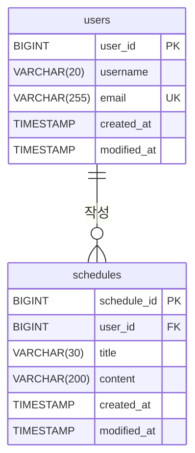

## API 명세서

### 일정(schedule)

|Method|URI|기능|
|--|--|--|
|POST|`/api/v1/schedules`|일정 생성|
|GET|`/api/v1/schedules`|일정 전체 조회|
|GET|`/api/v1/schedules/{scheduleId}`|일정 단건 조회|
|PATCH|`/api/v1/schedules/{scheduleId}`|일정 수정|
|DELETE|`/api/v1/schedules/{scheduleId}`|일정 삭제|

<details>
<summary><h3>일정 생성</h3></summary>

할일 제목, 할일 내용, 작성자 ID를 입력받아 새로운 일정을 생성합니다.<br>
작성일과 수정일은 서버에서 자동으로 저장됩니다.

|메서드|요청 URL|
|--|--|
|POST|`/api/v1/schedules`

**Request Headers**

|Key|Value|필수|설명|
|--|--|--|--|
|`Content-Type`|`application/json`|✅|요청 본문 형식|

**Request Body**

|필드|타입|필수|설명|
|--|--|--|--|
|`title`|String|✅| 할일 제목 (공백 불가, 최대 30자)|
|`content`|String|✅| 할일 내용 (공백 불가, 최대 200자)|
|`userId`|Long|✅| 작성자 ID (존재하는 유저여야 함)|

```json
{
    "title": "할일 제목",
    "content": "할일 내용",
    "userId": 1
}
```
**Response Body** `201 Created`

|필드|타입|설명|
|--|--|--|
|`scheduleId`|Long|일정 ID|
|`title`|String|할일 제목|
|`content`|String|할일 내용|
|`userId`|Long|작성자 ID|
|`createdAt`|LocalDateTime|작성일
|`modifiedAt`|LocalDateTime|수정일

```json
{
    "scheduleId": 1,
    "title": "할일 제목",
    "content": "할일 내용",
    "userId": 1,
    "createdAt": "2026-10-16T14:30:00",
    "modifiedAt": "2026-10-16T14:30:00"
}
```

**Error Response**

|상태 코드|상황|
|--|--|
|`400 Bad Request`|입력값 검증 실패 (필수값 누락, 제목·내용 공백, 제목 30자 초과, 내용 200자 초과)|
|`404 Not Found`|존재하지 않는 유저 ID (`userId`)|

</details>

<details>
<summary><h3>일정 전체 조회</h3></summary>

전체 일정을 수정일 기준 내림차순으로 조회합니다.<br>
작성자 ID(`userId`)를 입력하면 해당 유저의 일정만 조회합니다.

|메서드|요청 URL|
|--|--|
|GET|`/api/v1/schedules`

**Query Parameter**

|필드|타입|필수|설명|
|--|--|--|--|
|`userId`|Long|❌| 작성자 ID

**Response Body** `200 OK`

> 수정일(`modifiedAt`) 기준 내림차순 정렬

|필드|타입|설명|
|--|--|--|
|`scheduleList`|List|일정 목록|
|`scheduleList[].scheduleId`|Long|일정 ID|
|`scheduleList[].title`|String|할일 제목|
|`scheduleList[].content`|String|할일 내용|
|`scheduleList[].userId`|Long|작성자 ID|
|`scheduleList[].createdAt`|LocalDateTime|작성일|
|`scheduleList[].modifiedAt`|LocalDateTime|수정일|

```json
{
    "scheduleList": [
        {
            "scheduleId": 1,
            "title": "제목",
            "content": "내용",
            "userId": 1,
            "createdAt": "2026-10-14T17:09:00",
            "modifiedAt": "2026-10-14T17:09:00"
        },
        {
            "scheduleId": 3,
            "title": "제목",
            "content": "내용",
            "userId": 2,
            "createdAt": "2026-10-08T17:09:00",
            "modifiedAt": "2026-10-08T17:09:00"
        },
        {
            "scheduleId": 4,
            "title": "제목",
            "content": "내용",
            "userId": 2,
            "createdAt": "2026-10-07T17:09:00",
            "modifiedAt": "2026-10-07T17:09:00"
        },
        {
            "scheduleId": 2,
            "title": "제목",
            "content": "내용",
            "userId": 1,
            "createdAt": "2026-09-14T17:09:00",
            "modifiedAt": "2026-09-14T17:09:00"
        }
    ]
}
```

</details>

<details>
<summary><h3>일정 단건 조회</h3></summary>

일정 ID로 특정 일정 하나를 조회합니다.

|메서드|요청 URL|
|--|--|
|GET|`/api/v1/schedules/{scheduleId}`

**Response Body** `200 OK`

|필드|타입|설명|
|--|--|--|
|`scheduleId`|Long|일정 ID|
|`title`|String|할일 제목|
|`content`|String|할일 내용|
|`userId`|Long|작성자 ID|
|`createdAt`|LocalDateTime|작성일
|`modifiedAt`|LocalDateTime|수정일

```json
{
    "scheduleId": 2,
    "title": "제목",
    "content": "내용",
    "userId": 1,
    "createdAt": "2026-09-14T17:09:00",
    "modifiedAt": "2026-09-14T17:09:00"
}
```

**Error Response**

|상태 코드|상황|
|--|--|
|`404 Not Found`|존재하지 않는 일정 ID|

</details>

<details>
<summary><h3>일정 수정</h3></summary>

일정 ID로 특정 일정의 할일 제목이나 할일 내용을 수정합니다.<br>
수정할 필드만 보내면 되고, 최소 1개는 보내야 합니다. 수정일은 자동으로 갱신됩니다.

|메서드|요청 URL|
|--|--|
|PATCH|`/api/v1/schedules/{scheduleId}`

**Request Headers**

|Key|Value|필수|설명|
|--|--|--|--|
|`Content-Type`|`application/json`|✅|요청 본문 형식|

**Request Body**

|필드|타입|필수|설명|
|--|--|--|--|
|`title`|String|❌| 할일 제목 (공백 불가, 최대 30자)|
|`content`|String|❌| 할일 내용 (공백 불가, 최대 200자)|

```json
{
    "title": "할일 제목",
    "content": "할일 내용"
}
```
**Response Body** `200 OK`

|필드|타입|설명|
|--|--|--|
|`scheduleId`|Long|일정 ID|
|`title`|String|할일 제목|
|`content`|String|할일 내용|
|`userId`|Long|작성자 ID|
|`createdAt`|LocalDateTime|작성일
|`modifiedAt`|LocalDateTime|수정일

```json
{
    "scheduleId": 1,
    "title": "할일 제목",
    "content": "할일 내용",
    "userId": 1,
    "createdAt": "2026-10-15T09:00:00",
    "modifiedAt": "2026-10-16T14:30:00"
}
```

**Error Response**

|상태 코드|상황|
|--|--|
|`400 Bad Request`|입력값 검증 실패 (제목·내용 공백, 제목 30자 초과, 내용 200자 초과)|
|`400 Bad Request`|수정할 필드를 하나도 보내지 않음|
|`404 Not Found`|존재하지 않는 일정 ID|

</details>

<details>
<summary><h3>일정 삭제</h3></summary>

일정 ID로 특정 일정을 삭제합니다.

|메서드|요청 URL|
|--|--|
|DELETE|`/api/v1/schedules/{scheduleId}`

**Response** `204 No Content`

**Error Response**

|상태 코드|상황|
|--|--|
|`404 Not Found`|존재하지 않는 일정 ID|

</details>

### 유저(user)

|Method|URI|기능|
|--|--|--|
|POST|`/api/v1/users`|유저 생성|
|GET|`/api/v1/users`|유저 전체 조회|
|GET|`/api/v1/users/{userId}`|유저 단건 조회|
|PATCH|`/api/v1/users/{userId}`|유저 수정|
|DELETE|`/api/v1/users/{userId}`|유저 삭제|

<details>
<summary><h3>유저 생성</h3></summary>

유저명과 이메일을 입력받아 새로운 유저를 생성합니다.<br>
이메일은 중복될 수 없습니다. 작성일과 수정일은 서버에서 자동으로 저장됩니다.

|메서드|요청 URL|
|--|--|
|POST|`/api/v1/users`

**Request Headers**

|Key|Value|필수|설명|
|--|--|--|--|
|`Content-Type`|`application/json`|✅|요청 본문 형식|

**Request Body**

|필드|타입|필수|설명|
|--|--|--|--|
|`username`|String|✅| 유저명 (공백 불가, 최대 20자)|
|`email`|String|✅| 이메일 (이메일 형식, 최대 255자, 중복 불가)|

```json
{
    "username": "홍길동",
    "email": "gildong@example.com"
}
```
**Response Body** `201 Created`

|필드|타입|설명|
|--|--|--|
|`userId`|Long|유저 ID|
|`username`|String|유저명|
|`email`|String|이메일|
|`createdAt`|LocalDateTime|작성일|
|`modifiedAt`|LocalDateTime|수정일|

```json
{
    "userId": 1,
    "username": "홍길동",
    "email": "gildong@example.com",
    "createdAt": "2026-10-01T14:30:00",
    "modifiedAt": "2026-10-01T14:30:00"
}
```

**Error Response**

|상태 코드|상황|
|--|--|
|`400 Bad Request`|입력값 검증 실패 (필수값 누락, 유저명 공백·20자 초과, 이메일 형식 오류·255자 초과)|
|`409 Conflict`|이미 사용 중인 이메일|

</details>

<details>
<summary><h3>유저 전체 조회</h3></summary>

전체 유저를 가입일(작성일) 기준 내림차순으로 조회합니다.

|메서드|요청 URL|
|--|--|
|GET|`/api/v1/users`

**Response Body** `200 OK`

> 가입일(`createdAt`) 기준 내림차순 정렬

|필드|타입|설명|
|--|--|--|
|`userList`|List|유저 목록|
|`userList[].userId`|Long|유저 ID|
|`userList[].username`|String|유저명|
|`userList[].email`|String|이메일|
|`userList[].createdAt`|LocalDateTime|작성일|
|`userList[].modifiedAt`|LocalDateTime|수정일|

```json
{
    "userList": [
        {
            "userId": 3,
            "username": "이영희",
            "email": "younghee@example.com",
            "createdAt": "2026-10-15T11:45:00",
            "modifiedAt": "2026-10-15T11:45:00"
        },
        {
            "userId": 2,
            "username": "김철수",
            "email": "chulsoo@example.com",
            "createdAt": "2026-10-10T09:00:00",
            "modifiedAt": "2026-10-22T18:20:00"
        },
        {
            "userId": 1,
            "username": "홍길동",
            "email": "gildong@example.com",
            "createdAt": "2026-10-01T14:30:00",
            "modifiedAt": "2026-10-01T14:30:00"
        }
    ]
}
```

</details>

<details>
<summary><h3>유저 단건 조회</h3></summary>

유저 ID로 특정 유저 한 명을 조회합니다.

|메서드|요청 URL|
|--|--|
|GET|`/api/v1/users/{userId}`

**Response Body** `200 OK`

|필드|타입|설명|
|--|--|--|
|`userId`|Long|유저 ID|
|`username`|String|유저명|
|`email`|String|이메일|
|`createdAt`|LocalDateTime|작성일|
|`modifiedAt`|LocalDateTime|수정일|

```json
{
    "userId": 1,
    "username": "홍길동",
    "email": "gildong@example.com",
    "createdAt": "2026-10-01T14:30:00",
    "modifiedAt": "2026-10-01T14:30:00"
}
```

**Error Response**

|상태 코드|상황|
|--|--|
|`404 Not Found`|존재하지 않는 유저 ID|

</details>

<details>
<summary><h3>유저 수정</h3></summary>

유저 ID로 특정 유저의 유저명이나 이메일을 수정합니다.<br>
수정할 필드만 보내면 되고, 최소 1개는 보내야 합니다. 이메일은 다른 유저와 중복될 수 없습니다. 수정일은 자동으로 갱신됩니다.

|메서드|요청 URL|
|--|--|
|PATCH|`/api/v1/users/{userId}`

**Request Headers**

|Key|Value|필수|설명|
|--|--|--|--|
|`Content-Type`|`application/json`|✅|요청 본문 형식|

**Request Body**

|필드|타입|필수|설명|
|--|--|--|--|
|`username`|String|❌| 유저명 (공백 불가, 최대 20자)|
|`email`|String|❌| 이메일 (이메일 형식, 최대 255자, 중복 불가)|

```json
{
    "username": "홍길순",
    "email": "gilsoon@example.com"
}
```
**Response Body** `200 OK`

|필드|타입|설명|
|--|--|--|
|`userId`|Long|유저 ID|
|`username`|String|유저명|
|`email`|String|이메일|
|`createdAt`|LocalDateTime|작성일|
|`modifiedAt`|LocalDateTime|수정일|

```json
{
    "userId": 1,
    "username": "홍길순",
    "email": "gilsoon@example.com",
    "createdAt": "2026-10-01T14:30:00",
    "modifiedAt": "2026-10-24T09:15:00"
}
```

**Error Response**

|상태 코드|상황|
|--|--|
|`400 Bad Request`|입력값 검증 실패 (유저명 공백·20자 초과, 이메일 형식 오류·255자 초과)|
|`400 Bad Request`|수정할 필드를 하나도 보내지 않음|
|`404 Not Found`|존재하지 않는 유저 ID|
|`409 Conflict`|다른 유저가 이미 사용 중인 이메일|

</details>

<details>
<summary><h3>유저 삭제</h3></summary>

유저 ID로 특정 유저를 삭제합니다.

|메서드|요청 URL|
|--|--|
|DELETE|`/api/v1/users/{userId}`

**Response** `204 No Content`

**Error Response**

|상태 코드|상황|
|--|--|
|`404 Not Found`|존재하지 않는 유저 ID|

</details>


## ERD


## 테이블 명세서

### 공통 컬럼: `BaseEntity`

|칼럼 이름| 데이터타입|null 허용| key종류| 기본값| 설명|
|--|--|--|--|--|--|
|`created_at`|TIMESTAMP|❌|-|-|작성일 (최초 저장 시 자동 입력, 수정 불가)|
|`modified_at`|TIMESTAMP|❌|-|-|수정일 (저장·수정 시 자동 갱신)|

### 테이블명: `schedules`
|칼럼 이름| 데이터타입|null 허용| key종류| 기본값| 설명|
|--|--|--|--|--|--|
|`schedule_id`|BIGINT|❌|PK|AUTO_INCREMENT|일정 ID|
|`user_id`|BIGINT|❌|FK|-|작성자 ID (`users.user_id` 참조)|
|`title`|VARCHAR(30)|❌|-|-|할일 제목|
|`content`|VARCHAR(200)|❌|-|-|할일 내용|
|`created_at`|TIMESTAMP|❌|-|-|작성일 (`BaseEntity` 상속)|
|`modified_at`|TIMESTAMP|❌|-|-|수정일 (`BaseEntity` 상속)|

### 테이블명: `users`

|칼럼 이름| 데이터타입|null 허용| key종류| 기본값| 설명|
|--|--|--|--|--|--|
|`user_id`|BIGINT|❌|PK|AUTO_INCREMENT|유저 ID|
|`username`|VARCHAR(20)|❌|-|-|유저명|
|`email`|VARCHAR(255)|❌|UNIQUE|-|이메일 (중복 불가)|
|`created_at`|TIMESTAMP|❌|-|-|작성일 (`BaseEntity` 상속)|
|`modified_at`|TIMESTAMP|❌|-|-|수정일 (`BaseEntity` 상속)|
